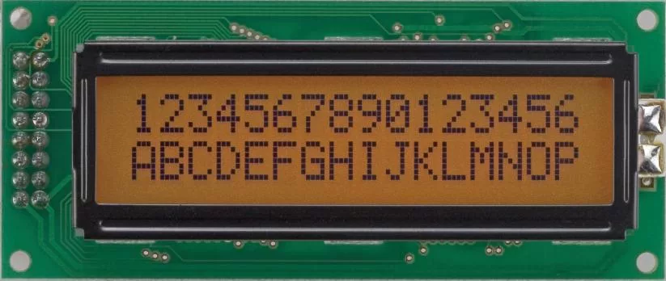

# HD44780 

```
Font metadata:
Name:        HD44780
Author:      aegis
License:     MIT
Characters:  261
```
Monospaced font that uses bitmap from Hitachi symbol displays, like LCD1602.



Contains all* symbols from display SGROM (by dataseets), and some more custom symbols.


