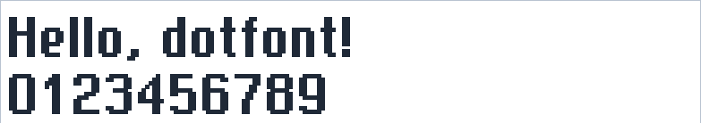

# N3310

```
Font metadata:
Name:        N3310 Small
Author:      GidroByte
License:     MIT
Characters:  169
```

Font converted from [nokia-3310-fonts-u8g2](https://github.com/GidroByte/nokia-3310-fonts-u8g2) project



